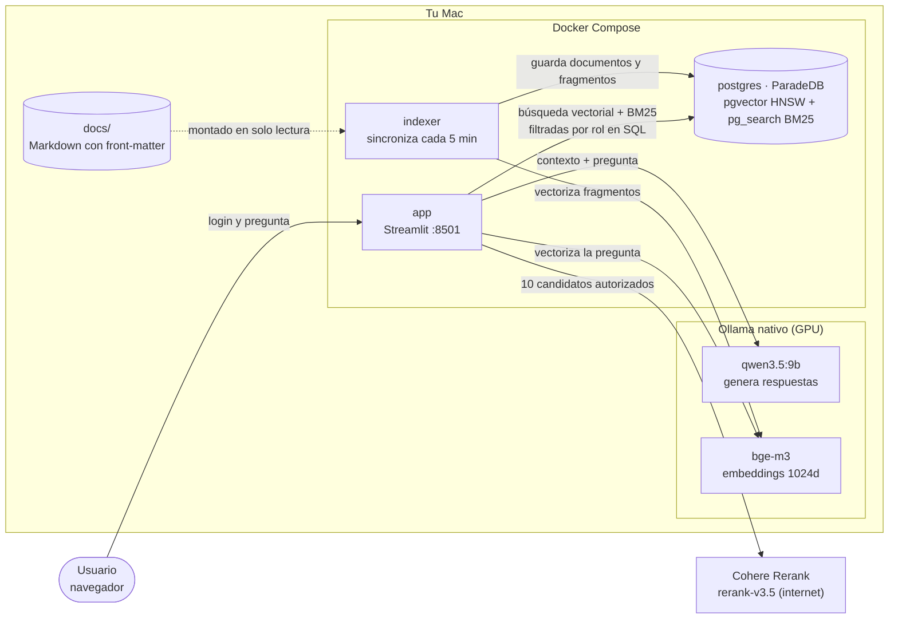
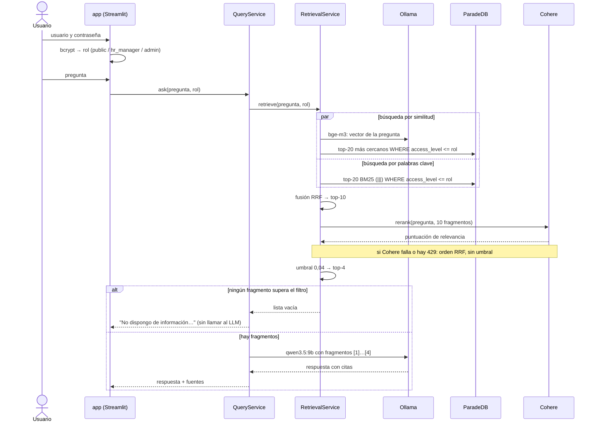
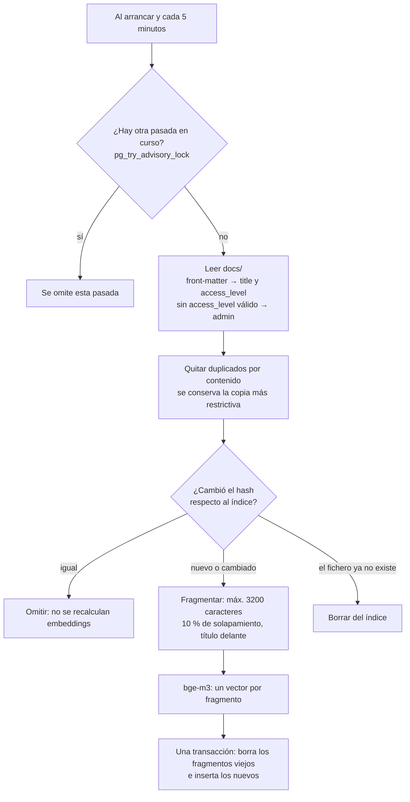
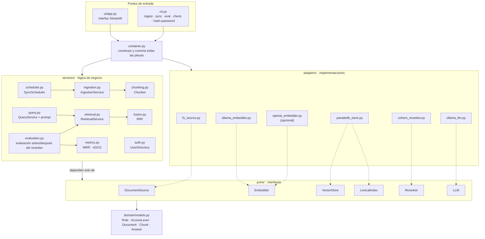
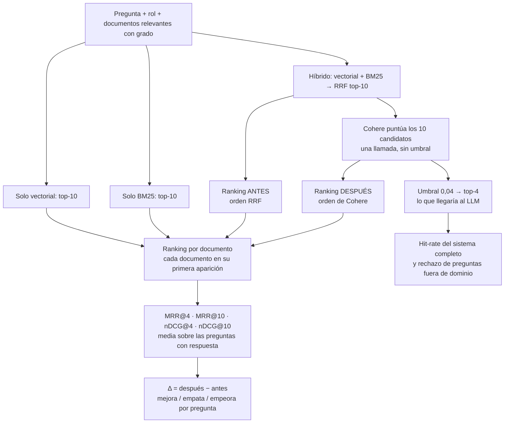

# Arquitectura del asistente RAG de RRHH

Cada diagrama está también como fichero `.mmd` independiente en esta carpeta (`01-arquitectura-sistema.mmd`, `02-flujo-pregunta.mmd`, `03-reindexacion.mmd`, `04-estructura-codigo.mmd`, `05-evaluacion.mmd`), útil para editarlo en [mermaid.live](https://mermaid.live) o exportarlo a imagen.

## 1. Arquitectura del sistema

Qué corre dónde y cómo se comunica. Ollama corre en el Mac (con GPU) y los contenedores lo alcanzan en `host.docker.internal:11434`. Lo único que sale a internet es la llamada al reranker de Cohere, y solo con fragmentos que el rol del usuario ya puede ver.

## 2. Qué pasa cuando alguien pregunta

## 3. Cómo se mantiene el índice al día

## 4. Cómo está organizado el código

Arquitectura por capas. Los servicios solo conocen interfaces (`ports/`); `container.py` es el único sitio que elige las implementaciones concretas (`adapters/`). Para cambiar Cohere por otro reranker u Ollama por otro LLM basta con un adaptador nuevo y una línea en `container.py`.

| Interfaz (`ports/`) | Implementación (`adapters/`) | Qué hace |
|---|---|---|
| `DocumentSource` | `fs_source.py` | Lee `docs/` y su front-matter |
| `Embedder` | `ollama_embedder.py` (`openai_embedder.py` opcional) | Convierte texto en vectores de 1024 dimensiones |
| `VectorStore` | `paradedb_store.py` | Guarda fragmentos y busca por similitud filtrando por rol |
| `LexicalIndex` | `paradedb_store.py` | Búsqueda BM25 filtrando por rol |
| `Reranker` | `cohere_reranker.py` | Reordena los 10 candidatos por relevancia |
| `LLM` | `ollama_llm.py` | Genera la respuesta con `qwen3.5:9b` |

## 5. Cómo se evalúa si el reranker aporta

`python -m roboost_rag eval` recorre `tests/eval/questions.yaml`. Cada pregunta lleva su rol y sus documentos relevantes con un grado (2 = responde directamente, 1 = relacionado). Para aislar el efecto del reranker, el "antes" y el "después" usan **los mismos 10 candidatos**; solo cambia el orden. Una sola llamada a Cohere por pregunta da las dos cosas.

- **MRR@k** (Mean Reciprocal Rank): media de `1 / posición` del primer documento relevante dentro de los k primeros (0 si no aparece). Mide lo arriba que sale la primera respuesta útil.
- **nDCG@k** (normalized Discounted Cumulative Gain): suma de `(2^grado − 1) / log2(posición + 1)` dividida por la de la ordenación ideal. Vale 1 si los documentos salen ordenados de más a menos relevante y premia que los de grado 2 vayan por delante de los de grado 1.
- **@4** es lo que llega al LLM; **@10**, todos los candidatos que ve el reranker.
